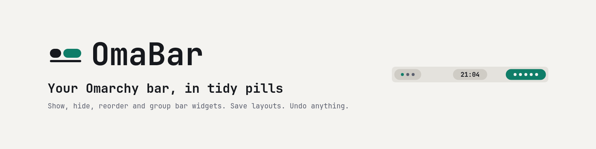
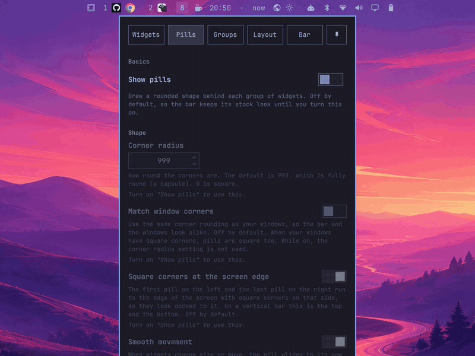
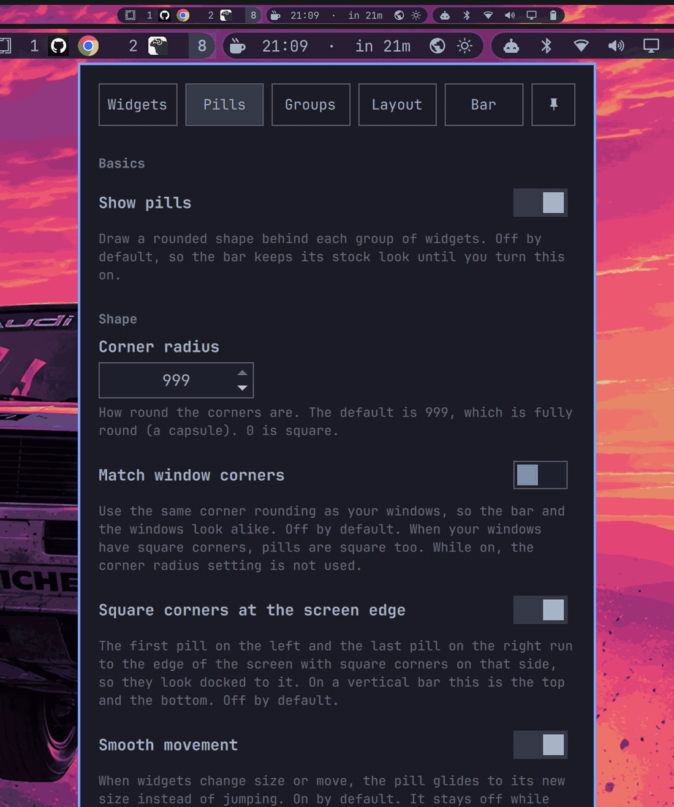
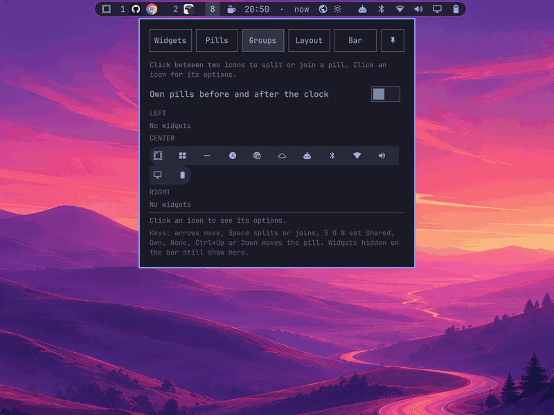
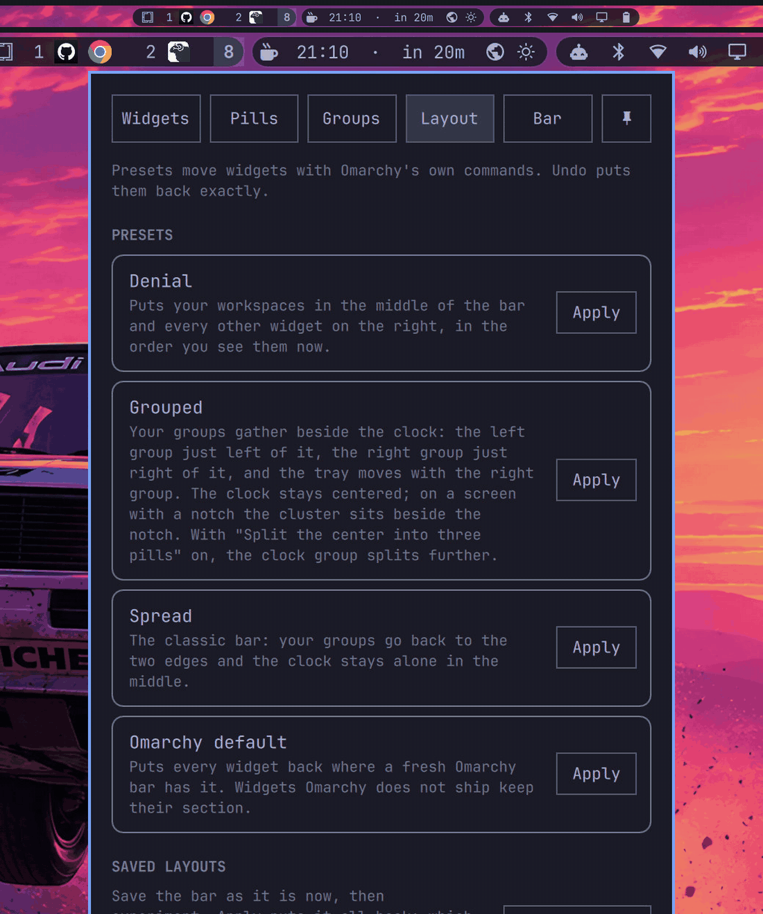
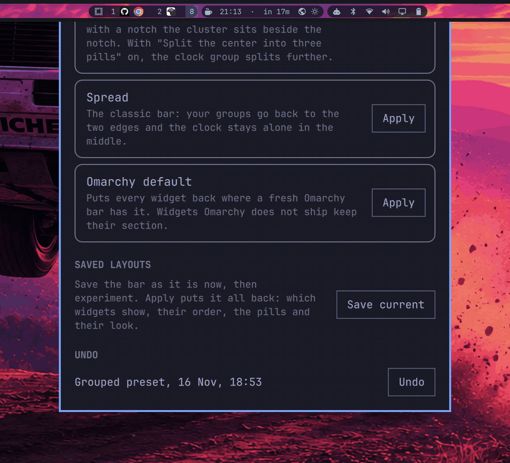
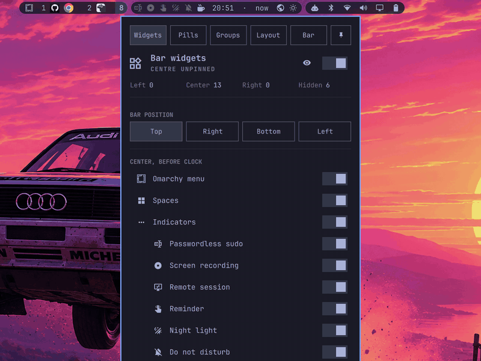
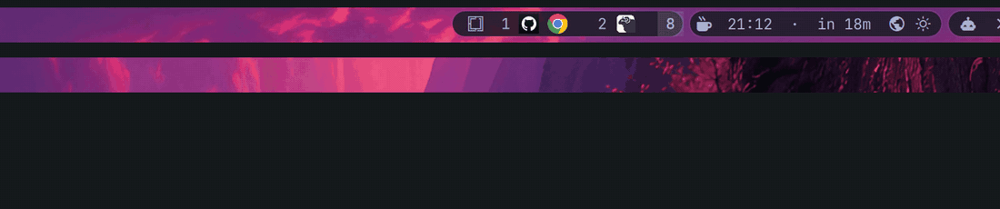
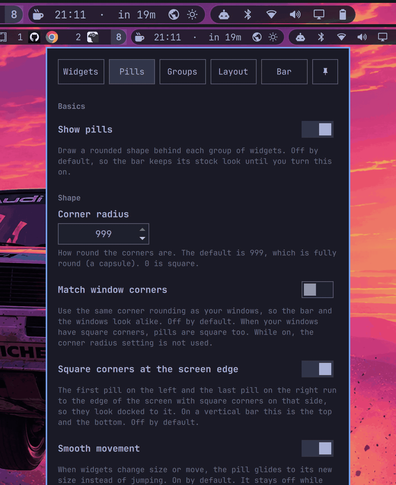

<p align="center">
  <picture>
    <source media="(prefers-color-scheme: dark)" srcset="branding/social/banner-dark.png">
    
  </picture>
</p>

<p align="center"></p>

# OmaBar

Show, hide, reorder and group the widgets on your Omarchy bar from one panel. Draw rounded **pills** behind groups of
widgets, try a layout preset, save your bar and bring it back later. Every change can be undone.

OmaBar opens from the Applications list:

```
Super+Space -> Apps -> OmaBar
```

Not affiliated with or endorsed by Omarchy or 37signals.

## What it does

### Pills behind your widgets

Turn on **Pills** and each section of the bar gets a rounded shape behind its widgets. Pick the corner radius, the
inner padding, the space above and below, the gap between pills, the fill and border color (a color from your theme,
so pills follow every theme switch), and their opacity. *Square corners at the screen edge* docks the outermost pills
to the edge of the screen. Pills glide when widgets change size.

<p align="center"></p>

### Groups: split and join pills on a mini bar

The **Groups** page draws each section as a small bar of icons. Click between two icons to split a pill there, click
again to join it. Click an icon to give it a pill of its own (**Own**), no pill at all (**None**, for widgets that draw
their own background, like a workspaces switcher), or to move its whole pill to another section. Everything works from
the keyboard too: arrows move, Space splits or joins, S, O and N set Shared, Own and None, Ctrl+Up and Ctrl+Down move
the pill.

<p align="center"></p>

### Layout presets and Undo

**Spread** puts your groups at both edges with the clock alone in the middle. **Denial** puts your workspaces in the
middle and everything else on the right. **Grouped** gathers your groups beside the clock. **Omarchy default** puts
every widget back where a fresh Omarchy bar has it. One **Undo** puts the bar back exactly as it was, byte for byte.

<p align="center"></p>

### Saved layouts

Save the bar as it is now, give it a name, then experiment. **Apply** brings it all back: which widgets show, their
order, their own settings, the pills and their look. Undo covers an Apply too.

<p align="center"></p>

### Show and hide widgets, one indicator at a time

The **Widgets** page lists every widget on the bar with a switch, grouped by section, and puts a hidden widget back
where it was, with its settings. Omarchy's indicators (night light, do not disturb, screen recording and others) live
inside one widget; OmaBar lists each one on its own row so you can hide just the ones you do not want. *Always show
indicators* stops the indicators from widening on hover, so nothing on the bar moves.

<p align="center"></p>

### Works on a vertical bar

Pills turn with the bar on the left or right side of the screen.

<p align="center"></p>

### Pin the panel

The pin button keeps the panel open while you click and type in other windows, so you can test a change on the real
bar. Esc closes it.

## A known limit, and the fix

Omarchy places bar widgets right next to each other, with no space between them. Where two pills meet, the only room
is the empty space inside the two widgets, so those ends can look tight. OmaBar pads from each widget's visible icons
rather than its box, which helps, and one Omarchy **spacer** widget (`omarchy bar put omarchy.spacer`) adds real room
at one spot. Omarchy's commands allow one spacer per bar; OmaBar treats it as space between pills.

**Tip for the Spaces widget:** if you use Spaces inside a pill, set its own *Pill shape* to *oval*
(`omarchy bar set tornikegomareli.spaces pillShape oval`), so the box behind the active workspace has round ends that
match the pill. With *auto*, it follows your window corners and can be square.

<p align="center"></p>

## Install

```bash
git clone https://github.com/felipecpaiva/OmaBarConfigurator.git
cd OmaBarConfigurator
./install.sh
```

No sudo. Re-running it is safe. Uninstall with `./uninstall.sh`.

What `install.sh` touches, and nothing else:

| Path | What lands there |
|---|---|
| `~/.config/omarchy/plugins/io.github.felipecpaiva.omabarconfigurator/` | the plugin itself |
| `~/.config/omarchy/shell.json` | the plugin entry and one invisible **OmaBar pills** bar entry, via `omarchy plugin enable` |
| `~/.local/share/applications/omabarconfigurator.desktop` | the Applications entry |
| `~/.local/share/icons/hicolor/256x256/apps/omabar.png` | its icon |

The **OmaBar pills** entry takes no space and draws nothing until you turn pills on. Keep it on the bar: it is what
draws the pills. If you remove it by hand, put it back with:

```bash
omarchy plugin enable io.github.felipecpaiva.omabarconfigurator
```

OmaBar never writes `bar.layout` on its own. It moves, shows and hides widgets only when you ask, with Omarchy's own
`omarchy bar` and `omarchy plugin` commands. Its settings live in `~/.config/omarchy/oma-bar-configurator.json`.

### Optional: a menu row as well

App rows are searchable but not routable, so `omarchy menu summon` cannot reach one. For a keybindable route, add a
static row to your menu extensions, which survives `omarchy update`:

```jsonc
// ~/.config/omarchy/extensions/omarchy-menu.jsonc
"apps.bar-configurator": {"icon":"󰍜","label":"OmaBar","action":"omarchy-shell shell toggle io.github.felipecpaiva.omabarconfigurator"},
```

Only whole-line `//` comments are allowed in that file: an inline trailing comment breaks the parse and silently drops
every entry in it. `install.sh` does not write this line, because that file is yours.

## Removal

```bash
./uninstall.sh
```

It removes the plugin, its plugin and bar entries (one `omarchy plugin disable` at a time until none is left), the
Applications entry it wrote (only if it carries `X-OmaBarConfigurator-Managed=true`) and its icon. It leaves your
settings file in place, so a reinstall still knows where your hidden widgets came from. Your `bar.layout` is not
touched: anything you hid stays hidden, so turn it back on in the panel first if you want it.

## Requirements

- **Omarchy** with its Quickshell desktop running (`omarchy-shell shell ping` answers `ok`).
- **`jq`**, already a dependency of Omarchy's own plugin CLI.

Nothing else: no bundled libraries, no network access, no build step. The panel uses Omarchy's own `qs.Ui` and
`qs.Commons` components at runtime; no Omarchy source is copied into this repository. Pills cost no measurable CPU or
memory at idle ([measurement](docs/research/cost.md)).

## Credits

- The idea of one invisible bar entry that paints behind the other widgets comes from **Islands** by PhyAMR.
- Pill looks and options were studied from **Islands Bar**, **Nyxiri** and **Denial**, Omarchy bar setups shared by
  the community. No code was copied from them.
- Omarchy is MIT-licensed by 37signals.

## License

MIT, see [LICENSE](LICENSE). The logo and artwork in `branding/` were made for this project and are released under
the same licence.
