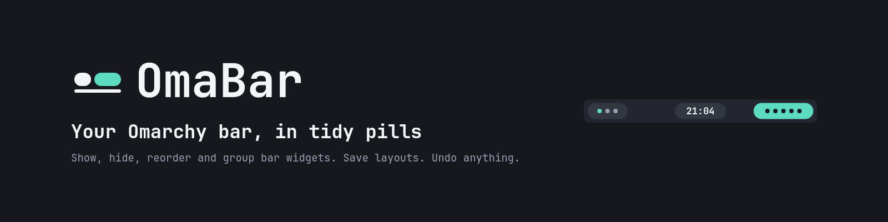
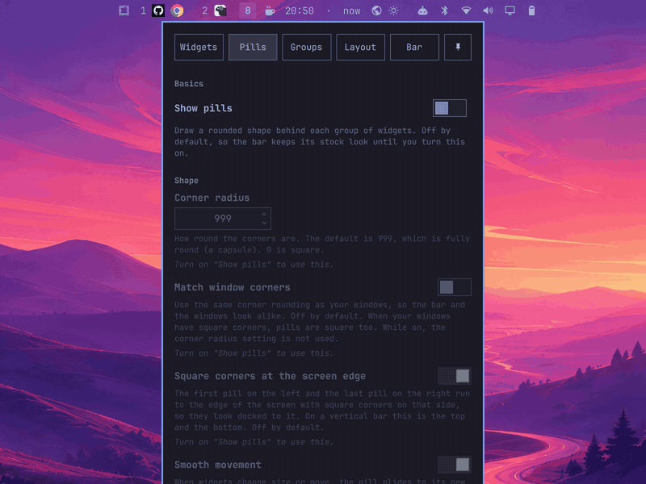
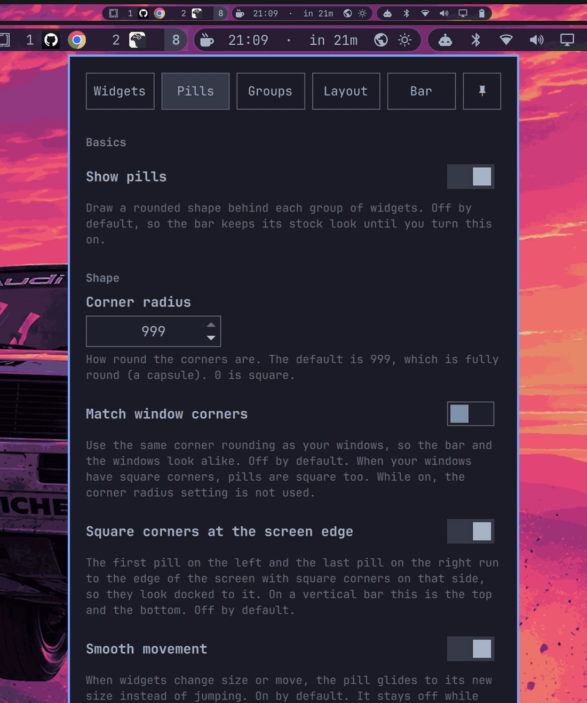
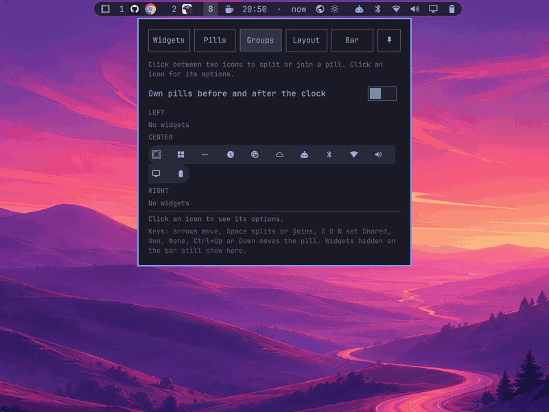
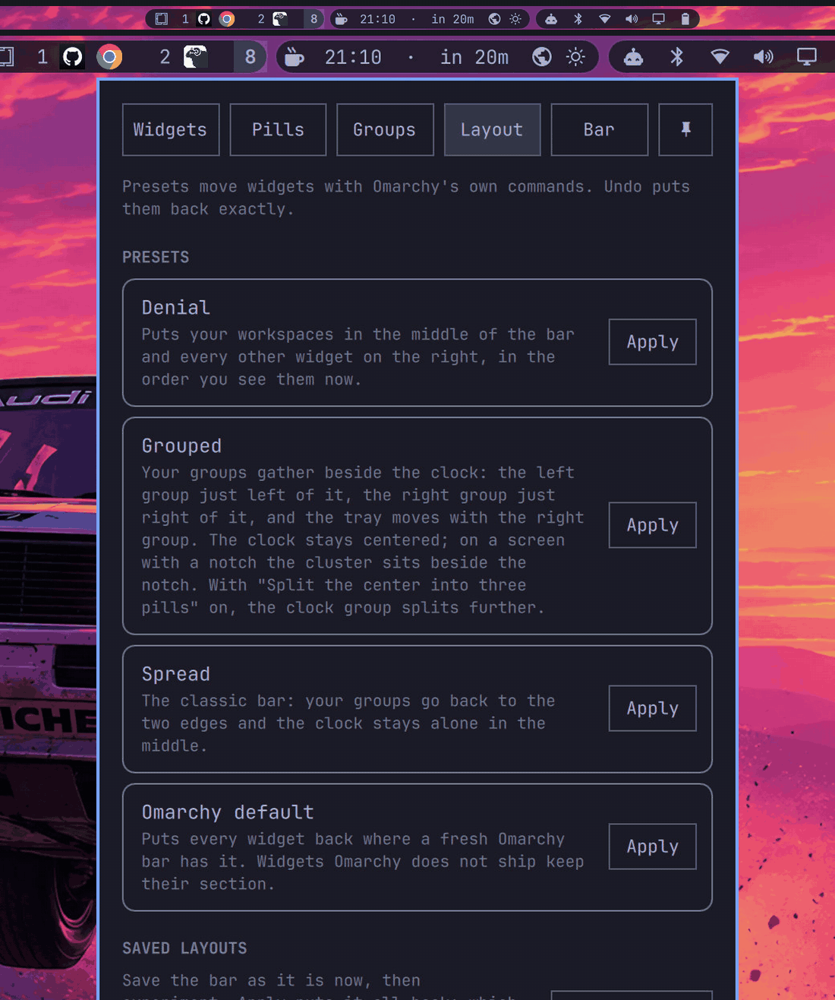
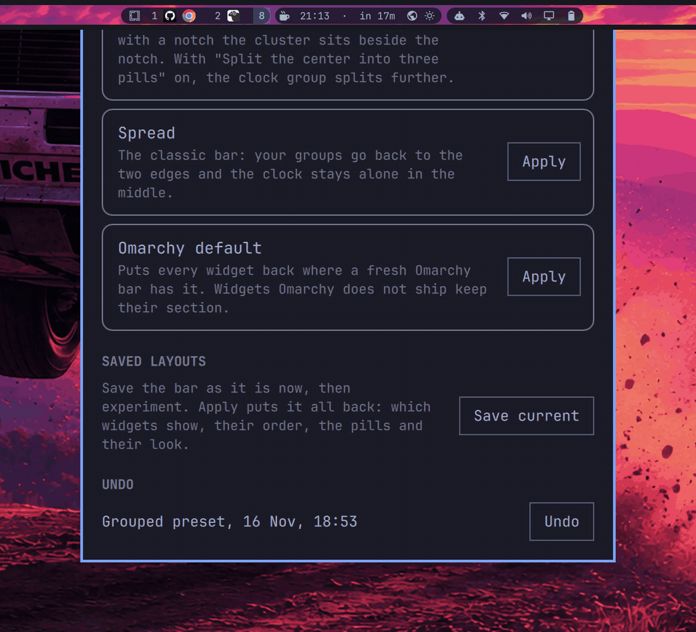
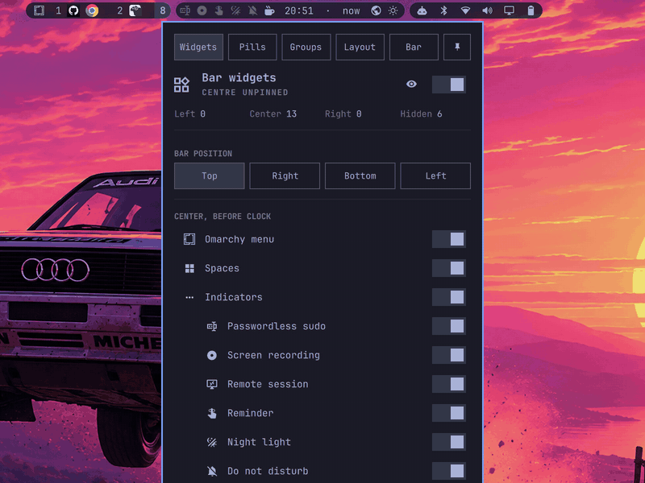
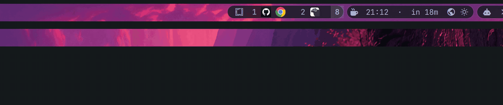

Pills, groups, layout presets and saved layouts for your Omarchy bar. Everything from v0.1.0 (show, hide and reorder widgets) still works the same.





## What is new

- **Pills behind your widgets.** Turn on Pills and each section of the bar gets a rounded shape behind its widgets. Corner radius (or match your window corners), inner padding, space above and below, gap between pills, fill and border color from your theme, opacity. Pills follow every theme switch and glide when widgets change size. Off by default, so nothing changes until you turn it on.
- **Square corners at the screen edge.** The outermost pills run to the edge of the screen with square corners on that side, so they look docked. Works on a vertical bar too.



- **Groups page: a mini bar with seams.** Each section is drawn as a small bar of icons. Click between two icons to split a pill there, click again to join. Click an icon for its options: Shared, **Own** (a pill of its own) or **None** (no pill, for widgets that draw their own background), and move its whole pill to another section. Full keyboard: arrows, Space, S O N, Ctrl+Up and Ctrl+Down.



- **Layout presets with Undo.** Spread (groups at both edges), Denial (workspaces in the middle, the rest on the right), Grouped (everything beside the clock) and Omarchy default. One Undo puts the bar back exactly, byte for byte.



- **Saved layouts.** Save the bar as it is now, name it, experiment, then Apply: which widgets show, their order, their own settings, the pills and their look all come back. Undo covers an Apply too. Up to 10.



- **Indicators one by one.** Omarchy's indicators (night light, do not disturb, screen recording and others) live in one widget. OmaBar lists each on its own row in Widgets, and in Bar, so you hide only the ones you do not want. **Always show indicators** stops them from widening the bar on hover.



- **Pin the panel** to keep it open while you click and type in other windows.
- **Settings by topic**: Widgets, Pills, Groups, Layout and Bar tabs, Tab and Shift+Tab to switch.
- **New name and brand.** The app is now called OmaBar in the menu, with its own icon. The plugin id is unchanged, so updating keeps your settings.



## How it works

The plugin adds one invisible **OmaBar pills** entry to the bar. It takes no space and draws nothing until pills are on; then it draws the pills behind the other widgets. Nothing in Omarchy is forked or copied. Pills pad from each widget's visible icons, not its box, so a widget that draws its icon at its edge gets the same room as one with inner margins. Moves, shows and hides go through Omarchy's own `omarchy bar` and `omarchy plugin` commands, and only when you ask.

## How it was checked

Node tests for every pure part (pill geometry, groups, seams and keyboard steps, presets with 2000 random layouts, saved layouts, style and store parsing, indicator lists, the safety rules of install and uninstall), `qmllint` on every QML file, and a runner that blocks timers in the painter and private bar names outside one adapter file. Live on Omarchy 4.5: every feature on the real bar with before and after screenshots, Denial then Undo byte identical, saved layout Save, Apply and Undo compared file by file, White and Tokyo Night themes, Solid and Clear bars, the bar on the left side. Idle cost measured over ten 60 second windows: pills on used no more CPU or memory than pills off ([numbers](https://github.com/felipecpaiva/OmaBarConfigurator/blob/master/docs/research/cost.md)).

## Known limits

- **Omarchy puts no space between widgets.** Where two pills meet, the only room is inside the two widgets, so those ends can be tight. One `omarchy.spacer` fixes one spot (Omarchy's commands add one per bar). Until Omarchy has bar spacing ([suggestion #19146](https://github.com/omacom/omarchy/discussions/19146)), OmaBar's own entry can be a second spacer: **Bar > Spacing > Extra gap**.
- If you use the Spaces widget inside a pill, set its *Pill shape* to *oval* so its active box matches the round pill ends.
- Not tested: a second monitor, the bar on the right or bottom side, and CPU while the pointer moves over the bar.

## Install or update

New install:

```bash
git clone https://github.com/felipecpaiva/OmaBarConfigurator.git
cd OmaBarConfigurator
./install.sh
```

Update: `cd OmaBarConfigurator && git pull && ./install.sh`, then `omarchy restart shell`. The installer adds the invisible **OmaBar pills** bar entry; keep it on the bar. Your settings in `~/.config/omarchy/oma-bar-configurator.json` are kept.

Credits: the idea of one invisible entry that paints behind the bar comes from **Islands** by PhyAMR; pill looks were studied from **Islands Bar**, **Nyxiri** and **Denial**. No code was copied.

OmaBar is an independent project, not affiliated with or endorsed by Omarchy or 37signals. MIT license.
